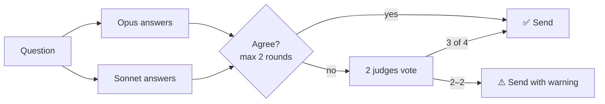

<h1 align="center">🥄<br>spoon</h1>

<p align="center"><b>Small spoon. Serious power.</b><br>
Tiny tokens: how much, how sure, what shape.</p>

---

## ⚡ Start in 30 seconds

Type `sp`, then a token or two, then your question:

```
sp 1m   why is my build slow?        → a 1-minute read
sp 3s   what is a mutex?             → 3 sentences
sp ver  is Node 22 LTS?              → checked before it's sent
sp 1m cr da   should we use Redis?   → 1 minute, crystal clear, with data
```

Tokens can also go at the end of the message. Every answer ends with 🥄 and a short note on what your tokens did.

---

## 📋 Cheat sheet

### 🍽️ Dosing — how much

| Token | You get |
|---|---|
| `{n}s` | `n` sentences (not seconds) |
| `{n}p` | `n` short paragraphs |
| `{n}m` | about `n` minutes to read (1m ≈ 200 words) |

> The dose always wins. Everything else must fit inside it.

### ✅ Verification — how sure

| Token | Level | What happens |
|---|---|---|
| `ver1` / `thoughtful` | 🧠 Thoughtful | care and sources, no subagents |
| `ver2` / `sampling` | 🔍 Sampling | subagents check key claims |
| `ver3` / `consensus` | 🤼 Consensus | two models must agree |
| `ver` | 🎯 Auto | easy → thoughtful, right/wrong → consensus, long research → sampling |

### ✨ Enhancers — how it's made

| Token | You get |
|---|---|
| `cr` / `crystal` | crystal clear, via subagents |
| `lay` | explained to a layman |
| `qu` | a question for you first |
| `in` / `out` | more / less detail |
| `da` / `data` | backed by verified data |

### 🎨 Formats — what shape

| Token | You get |
|---|---|
| `bul` | a few bullets with bold titles |
| `art` | an artifact |
| `html` | an HTML artifact |

### 🧰 Utilities

| Token | You get |
|---|---|
| `tips` | a two-line quick start |
| `sticky on` | keep the tokens for the session |
| `sticky off` | stop keeping them |

---

## 🚀 Powerful & advanced

<details>
<summary><b>Combine anything</b></summary>

```
sp 2p ver3 bul       → 2 paragraphs, as bullets, verified by consensus
sp 1m lay cr         → 1 minute, for a layman, crystal clear
sp 5s out html       → 5 sentences, big picture, as an HTML artifact
```
</details>

<details>
<summary><b>Set it once with <code>sticky</code></b></summary>

```
sp 1m bul sticky on   → every answer: 1 minute, bullets
sp sticky off         → back to normal
```
</details>

<details>
<summary><b>Crystal: a mini editing team</b></summary>

Claude writes a draft. Three helpers each suggest one edit:

- **Simplicity** — make it simpler
- **Completeness** — add a missing detail
- **Show, don't tell** — add an example

A judge accepts or rejects each edit. Only agreed edits go in.
</details>

---

## 🔬 How verification works

| Level | Cost | Best for |
|---|---|---|
| 🧠 Thoughtful | 💲 | easy, closed questions |
| 🔍 Sampling | 💲💲 | long, multi-part answers (a few sentences or less → consensus) |
| 🤼 Consensus | 💲💲💲 | right/wrong questions with few parts |

<details>
<summary><b>🔍 Sampling</b> — check the claims that matter</summary>

```
draft → pick up to 3 key claims → 1 subagent per claim → all correct? send : revise
```
</details>

<details>
<summary><b>🤼 Consensus</b> — two models argue until they agree</summary>



Claude is only the referee. It never votes.
</details>

---

## 📦 Install

**Claude Code** — plugin marketplace:

```
/plugin marketplace add goldbergyoni/skills
/plugin install spoon@goldbergyoni
```

**Codex** — plugin marketplace:

```bash
codex plugin marketplace add goldbergyoni/skills
codex plugin add spoon@goldbergyoni
```

**Any agent** — [skills.sh](https://skills.sh) (Claude Code, Codex, Cursor and more):

```bash
npx skills add goldbergyoni/skills --skill spoon
```

Then type `sp tips`.

<details>
<summary><b>🧪 Evals</b></summary>

```bash
cd evals && npm install && npm run eval
```

More in [`evals/README.md`](evals/README.md).
</details>

<p align="center">🥄</p>
